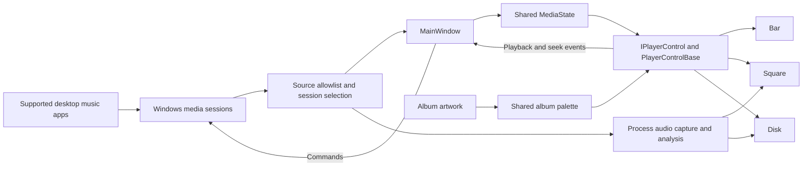

<p align="center"></p>

# SpotiFloat

A floating music controller for Windows, built with C# and WPF. See your current track, control playback and view audio activity without switching away from your work.

**Public development release: v1.2.0.** Download the Windows installer or build from source. Some artwork and live-service behaviours still need wider testing; see [known issues](docs/maintenance/fixes.md).

## Install

Download **[SpotiFloat-Setup-1.2.0-win-x64.exe](https://github.com/Inexplicable05/Spotify-widget-player/releases/download/v1.2.0/SpotiFloat-Setup-1.2.0-win-x64.exe)** from [Releases](https://github.com/Inexplicable05/Spotify-widget-player/releases/latest). It installs for your Windows account, includes the .NET runtime and adds a Start menu shortcut. Administrator access is not required. Uninstall through **Windows Settings → Apps → Installed apps**, Control Panel, or Settings → Advanced inside the installed app.

The installer is unsigned, so Windows may show an unknown-publisher or SmartScreen warning. Download only from this repository's releases. Preferences are retained on uninstall; **Clear data and exit** removes them separately.

## Features

- Three layouts: **Bar**, **Square** and **Disk**.
- **Dark**, **Light** and translucent **Glass** themes.
- Album colouring: **Off**, **Title**, **Accents** or **Full**.
- Play/pause, previous/next and seeking through the active Windows media session.
- Process-specific audio visualizers in Square and Disk.
- Adjustable size from **10% to 300%**, position locking, topmost/desktop positioning, fullscreen hiding and optional startup registration.
- Settings and Exit available by right-clicking the player or its tray icon.

## Supported music apps

Desktop editions of **Spotify, Apple Music, Amazon Music, Deezer and TIDAL** are allowlisted. The music app must expose a Windows media session; available metadata and commands depend on that app.

Browser sessions are intentionally excluded, including browser versions of supported services. Other media apps are excluded too. No account login or music-service API key is needed by SpotiFloat.

## Requirements

- Windows 10 version 2004 / build 19041 or later; Windows 11 is recommended.
- Process-specific visualization requires **Windows build 20348 or later** and an active supported audio process. On earlier builds the visualizer stays idle; playback controls can still work.
- To build: the **.NET 8 SDK** on Windows. Visual Studio is optional; its .NET desktop development workload is suitable.

## Run from source

```powershell
git clone https://github.com/Inexplicable05/Spotify-widget-player.git
cd Spotify-widget-player
dotnet restore SpotiFloat/SpotiFloat.csproj
dotnet run --project SpotiFloat/SpotiFloat.csproj
```

Start a supported desktop music app and play a track. Right-click the widget and choose **Settings** to change its layout and appearance. Use **Exit** to close it; closing Settings leaves the widget running.

Preferences are saved to `%APPDATA%\SpotiFloat\settings.json`. Startup registration, when enabled, uses the current user's Windows Run registry key. [Usage and troubleshooting](docs/usage.md) explains source filtering, visualizer limitations and cleanup.

## How it works

All layouts share one media integration and command path. Layouts receive the same `MediaState` through `IPlayerControl`; `PlayerControlBase` owns common interaction and seeking behaviour.



See [Architecture](docs/architecture.md) for session selection, command routing, audio and appearance flow diagrams.

## Build and check

```powershell
dotnet build SpotiFloat/SpotiFloat.csproj -c Release
dotnet run --project tests/SourcePolicyChecks
dotnet run --project tests/SettingsChecks
powershell -NoProfile -File tests/BuildScriptChecks.ps1
```

The default checks do not play audio, clear preferences or launch an uninstaller. The WPF checks render previews locally. An optional real audio isolation check is described in [Development](docs/development.md).

## Contributing

Read [CONTRIBUTING.md](CONTRIBUTING.md) for setup and change guidelines, and [SECURITY.md](SECURITY.md) for vulnerability reporting. Small fixes and reproducible bug reports are welcome. The Windows CI workflow builds the app and runs the automated checks.

## Licence and credits

SpotiFloat source is available under the [MIT licence](LICENSE). Dependency licences and notices are preserved in [THIRD-PARTY-NOTICES.md](THIRD-PARTY-NOTICES.md).

SpotiFloat is an independent project. Music-service names, artwork and third-party marks belong to their respective owners; this project is not affiliated with those services.
