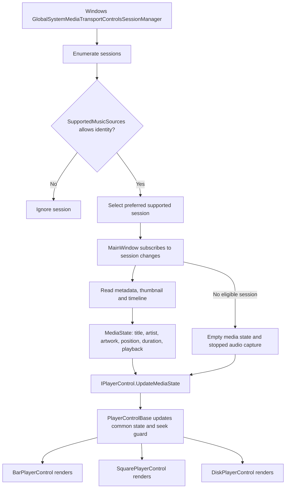
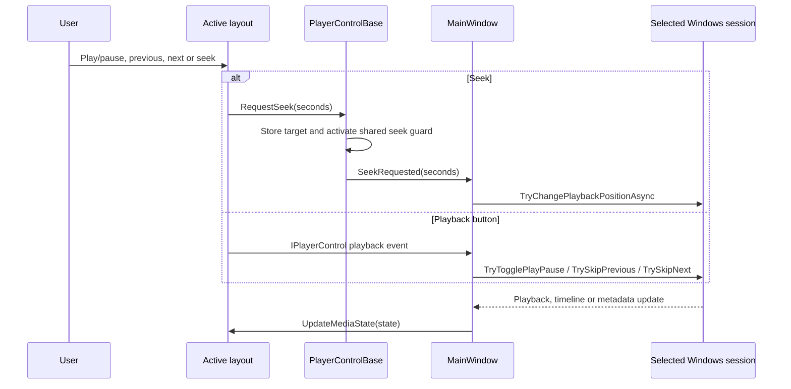
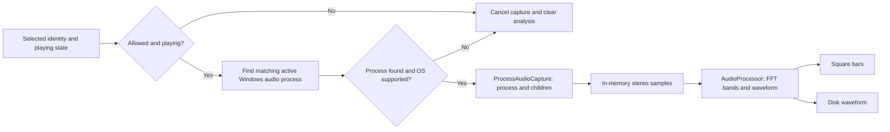
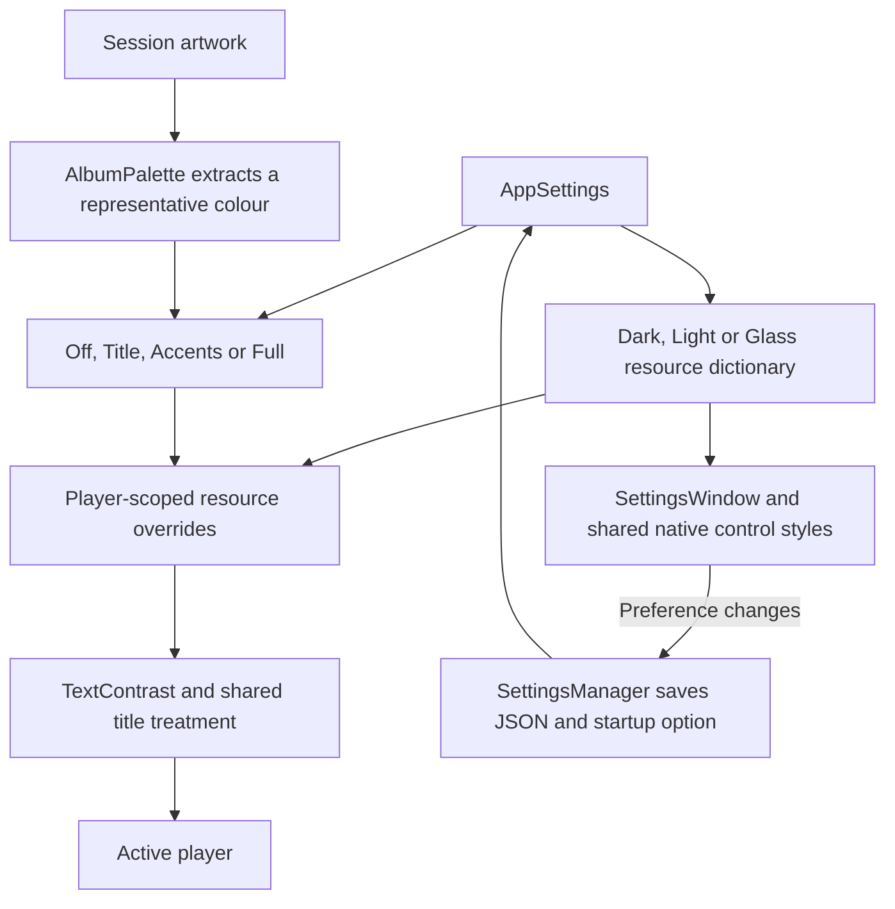

# Architecture

SpotiFloat is a native WPF app. `MainWindow` coordinates media sessions, the active layout, settings and appearance. The layouts do not each connect to the music apps.

## Shared media path

`SupportedMusicSources` matches app identities, not song titles. Browser processes never enter the allowlist. Session selection prefers, in order:

1. The Windows current session, if supported and playing.
2. The previously selected supported session, if still playing.
3. Another supported playing session.
4. The previous supported session, even if paused.
5. The first remaining supported session.

Session events trigger selection updates, with a two-second recheck as a fallback. A 500 ms UI timer refreshes media and window state. Music applications supply the metadata and supported commands; SpotiFloat does not fetch music from service APIs.

## Commands travel back through one contract

`IPlayerControl` defines the events, media-state update, title appearance and scale contract. `PlayerControlBase` shares playback fields, seek protection, artwork fallback and transitions, formatting and button handlers. Seeking temporarily protects the requested position from stale session reports. Each layout implements its own geometry, hit testing and rendering.

Switching layouts replaces the active control, reconnects the same event handlers, pushes the last media state and reapplies appearance. It does not create another media backend.

## Audio is a separate path

`ProcessAudioCapture` uses Windows application loopback and NAudio interop. `AudioProcessor` converts samples into 28 frequency bands and 64 waveform points. It switches capture with the selected process and clears data on pause, unsupported sources or capture failure. There is no system-output fallback or synthetic animation.

Process resolution currently matches allowed executable names against active audio sessions. A service update that changes its app identity or audio-host executable may require updating `SupportedMusicSources`.

## Appearance and settings

- **Off:** neutral theme colours.
- **Title:** artwork-derived title colour.
- **Accents:** title, media icons, progress fill/handle and visualizer.
- **Full:** accents plus a tint on the existing body/backdrop. Square and Disk retain their artwork; Glass retains transparency.

The extractor uses a small RGB histogram and selects a sampled colour from a representative bucket. It does not average the whole cover into one colour or artificially boost saturation. Contrast adjustments may change an accent's lightness. Full Bar uses a distinct opaque button surface and calculates icon contrast against that surface. Glass cannot guarantee surface separation against every possible wallpaper.

Overrides belong to the player, so album changes do not recolour Settings. Clearing artwork or changing modes restores the base theme resources.

## Source map

| Location | Responsibility |
|---|---|
| `SpotiFloat/MainWindow.xaml.cs` | Session selection, media commands, window behaviour and layout orchestration |
| `SpotiFloat/SupportedMusicSources.cs` | Shared source allowlist and executable mappings |
| `SpotiFloat/MediaState.cs`, `IPlayerControl.cs` | Shared state and layout contract |
| `SpotiFloat/Controls/PlayerControlBase.cs` | Common state, seeking and appearance behaviour |
| `SpotiFloat/Controls/*PlayerControl.*` | Layout-specific visuals and interactions |
| `SpotiFloat/AudioProcessor.cs`, `ProcessAudioCapture.cs` | Process audio capture and analysis |
| `SpotiFloat/AlbumPalette.cs`, `TextContrast.cs` | Palette selection, resource overrides and contrast |
| `SpotiFloat/Themes/` | Base theme tokens |
| `SpotiFloat/SettingsWindow.*`, `Controls/SettingsResources.xaml` | Settings layout and reusable native control styles |
| `SpotiFloat/SettingsManager.cs`, `InstallerSupport.cs` | Persistence, startup and installed-copy lookup |
| `tests/` | Windows source/audio and WPF appearance checks |
